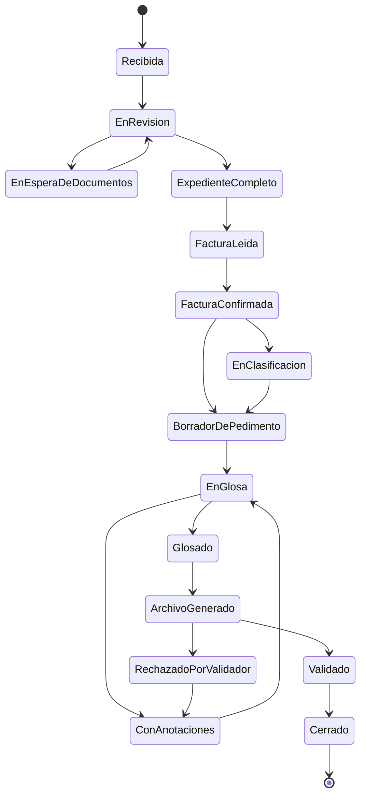

# Estatus de una referencia y Definición de Terminado

Tarea **S0-09** · Sprint 0 · SIDAPA

Este documento es el acuerdo del equipo sobre:

1. Los estatus por los que pasa una **referencia** (la operación de importación que agrupa documentos, facturas y pedimento).
2. De qué estatus se puede pasar a cuál.
3. Cuándo una tarea o historia de usuario se considera **terminada**.

---

## 1. Los 15 estatus de una referencia

| # | Estatus | Cuándo se pone | Quién lo provoca | HU |
|---|---|---|---|---|
| 1 | Recibida | El cliente creó el aviso de arribo y subió documentos. | Cliente | HU-02 |
| 2 | En revisión | El Capturador está revisando el expediente. | Capturador | HU-03, HU-05 |
| 3 | En espera de documentos | Se pidió al cliente un documento faltante o con error. | Capturador | HU-04 |
| 4 | Expediente completo | Todos los documentos requeridos están correctos. | Capturador | HU-03 |
| 5 | Factura leída | El sistema leyó la factura; falta que el Capturador la confirme. | Sistema (lector) | HU-06, HU-08 |
| 6 | Factura confirmada | El Capturador revisó y confirmó los datos leídos. | Capturador | HU-07 |
| 7 | En clasificación | Hay productos nuevos esperando fracción arancelaria del Glosador. | Sistema / Glosador | HU-09, HU-10 |
| 8 | Borrador de pedimento | El sistema generó el borrador; se completan transporte, contenedores y fechas. | Sistema / Capturador | HU-12 a HU-16 |
| 9 | En glosa | Pasó la revisión automática y está con el Glosador. | Sistema | HU-17, HU-18 |
| 10 | Con anotaciones | El Glosador dejó correcciones. | Glosador | HU-18, HU-19 |
| 11 | Glosado (Vo.Bo.) | El Glosador aprobó el pedimento. | Glosador | HU-18 |
| 12 | Archivo generado | Se generó el archivo de validación. | Sistema | HU-20 |
| 13 | Rechazado por validador | El validador regresó errores; vuelve a corrección. | Validador (externo) | HU-21, HU-19 |
| 14 | Validado | El validador aceptó el pedimento. | Validador (externo) | HU-21 |
| 15 | Cerrado | El expediente final está disponible para el cliente. | Sistema | HU-24 |

En el código:

- Enum: `SIDAPA.domain/Enums/Core/ReferenciaStatusEnum.cs` (el número es el `id_estatus`).
- Datos iniciales de la tabla `cat_estatus`: `StatusConfiguration.cs` (`HasData`) y la migración `SeedStatuses`.

---

## 2. Cambios de estatus permitidos

Una referencia solo puede pasar a los estatus de la columna **Puede pasar a**. Cualquier otro cambio lo rechaza el sistema con una `DomainException`.

| Estatus actual | Puede pasar a |
|---|---|
| Recibida | En revisión |
| En revisión | En espera de documentos · Expediente completo |
| En espera de documentos | En revisión (cuando el cliente sube el documento) |
| Expediente completo | Factura leída |
| Factura leída | Factura confirmada |
| Factura confirmada | En clasificación (si hay productos nuevos) · Borrador de pedimento |
| En clasificación | Borrador de pedimento |
| Borrador de pedimento | En glosa |
| En glosa | Con anotaciones · Glosado (Vo.Bo.) |
| Con anotaciones | En glosa (después de corregir) |
| Glosado (Vo.Bo.) | Archivo generado |
| Archivo generado | Validado · Rechazado por validador |
| Rechazado por validador | Con anotaciones |
| Validado | Cerrado |
| Cerrado | — (estado final) |

En el código: `SIDAPA.domain/Rules/Core/ReferenciaStatusFlow.cs` (`CanChange` y `EnsureCanChange`).
Cada cambio de estatus se guarda en la tabla `ope_bitacora_estatus` (`StatusHistoryEntity`).

---

